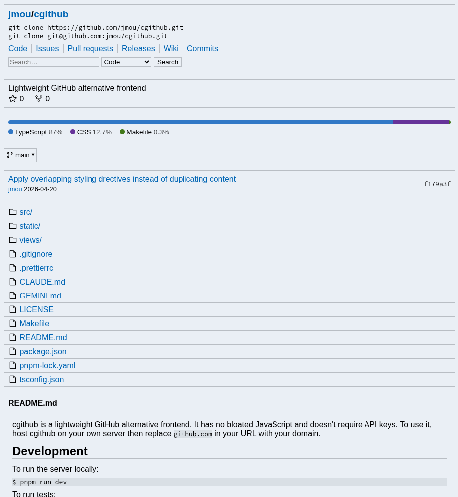

cgithub is a lightweight GitHub alternative frontend. It has no bloated
JavaScript and doesn't require API keys. It runs on Cloudflare Workers; to use
it, deploy your own instance then replace `github.com` in your URL with your
domain.



## Features

Implemented:

- Repository overview
- Directory listing and file browsing (`tree`/`blob`)
- Commit history (but this often results in 429 Too Many Requests on Cloudflare)
- Issue and pull request lists and search
- Discussions
- Release lists and details
- Wiki
- User and organization profiles

Not implemented:

- Pull request and commit details
- Issue and pull request status and labels in their lists
- Code search (GitHub requires signing in)
- Pagination (only the first page of issues, pull requests, discussions,
  commits, releases, branches, and tags is shown, and likewise only the replies
  GitHub sends with a discussion, and the timeline items it sends with an issue,
  rather than what is behind a "show more" button)
- Blame, contributors, stargazer/fork lists, network graphs, and insights
- Actions, checks, projects, packages, and gists
- Profile tabs other than the overview (repositories, projects, packages,
  people, sponsoring)
- Anything requiring an account: signing in, notifications, starring,
  commenting, editing, or any other write action
- Private repositories

## Browser extension redirects

cgithub redirects unsupported routes back to github.com. A browser extension
that rewrites github.com URLs to a cgithub instance with `declarativeNetRequest`
will match those redirects and send the request back, looping forever. To avoid
this, the extension should configure `excludedInitiatorDomains` with the cgithub
domain:

```jsonc
{
  "action": {
    "type": "redirect",
    "redirect": { "transform": { "host": "cgithub.example" } },
  },
  "condition": {
    "urlFilter": "||github.com",
    "resourceTypes": ["main_frame"],
    // So cgithub's own meta refresh to github.com isn't redirected back here.
    "excludedInitiatorDomains": ["cgithub.example"],
  },
}
```

## Related

- [GotHub](https://codeberg.org/gothub/gothub)

## Disclosures

AI coding assistants, in particular Claude, are used in the development process.

[Phospor Icons](https://phosphoricons.com/) used under MIT license.
